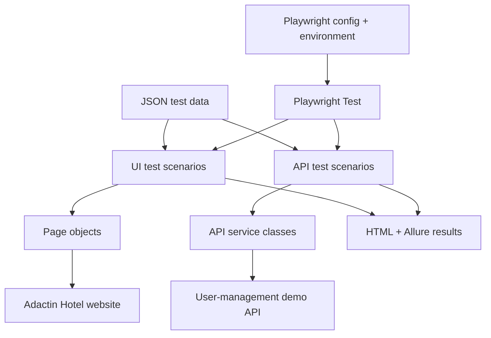

<div align="center">


<h1>Adactin Hotel Automation</h1>

<p><strong>JavaScript · Playwright · UI & API Testing</strong></p>
<p>A practical automation framework for hotel booking journeys and REST API validation.<br />Reusable page objects. JSON test data. Clear test evidence.</p>

<p>
  
  
  
</p>
<p>
  
  
  
  
</p>

<p>
  <a href="#overview">Overview</a> ·
  <a href="#architecture">Architecture</a> ·
  <a href="#quick-start">Quick Start</a> ·
  <a href="#run-tests">Run Tests</a> ·
  <a href="#reports">Reports</a> ·
  <a href="#jenkins">Jenkins</a>
</p>

</div>

---

<a id="overview"></a>
## 🎯 Overview

This repository brings browser automation and API checks into one Playwright project. The UI suite exercises the **Adactin Hotel application**, while the API suite validates a **separate user-management demo API**.

The framework separates test scenarios, page actions, API requests and test data so each part is easier to understand and maintain.

| Area | What the framework provides |
| --- | --- |
| 🏨 UI testing | Login, hotel search and selection, booking, confirmation and logout flows |
| 🔌 API testing | User registration, login, listing, account updates, deletion and negative scenarios |
| 🧩 Reusable code | Page Object Model for browser actions and service classes for API requests |
| 📋 Test data | JSON files for inputs, expected messages, URLs and API expectations |
| 🌐 Browser projects | Chromium, Firefox and WebKit with browser-specific authentication setup |
| 📸 Test evidence | Named steps, screenshot attachments, API response attachments and retry traces |
| 📊 Reporting | Console output, Playwright HTML reports and Allure result files |
| ⚙️ Automation | A Jenkins pipeline and a Dockerfile for container setup |

> The badges describe the tools and structure in this repository; they do not represent a live build result or a guaranteed pass rate.

<a id="technology"></a>
## 🛠️ Technology Stack

<p align="center">
  &nbsp;&nbsp;
  &nbsp;&nbsp;
  &nbsp;&nbsp;
  &nbsp;&nbsp;
  &nbsp;&nbsp;
  
</p>

| Technology | Purpose |
| --- | --- |
| JavaScript & Node.js | Test code and execution environment |
| Playwright Test | Test runner, browser automation, API requests and assertions |
| JSON & dotenv | Test data and environment settings |
| Allure & Playwright HTML | Test results and attached evidence |
| Jenkins | Checkout, dependency installation and automated execution |
| Docker | Container configuration |
| Git & GitHub | Source control and collaboration |

<a id="architecture"></a>
## 🧭 How the Framework Works

Tests describe **what to check**. Page objects and services describe **how to interact with the application**. JSON files supply the inputs and expected results.



**Hotel journey:** log in → search for a hotel → select a result → enter booking details → verify confirmation → log out.

**API approach:** create test data → send a request through a service → check the response → attach evidence where configured.

<a id="structure"></a>
## 📁 Project Structure

| Path | Responsibility |
| --- | --- |
| [`pages/`](pages/) | Locators and reusable actions for login, search, selection, booking, confirmation and logout |
| [`tests/`](tests/) | UI scenarios, smoke checks and authentication setup |
| [`tests/API/`](tests/API/) | API suites and unique test-user generation |
| [`services/`](services/) | Shared HTTP methods, authentication/user services and response logging |
| [`test_Data/`](test_Data/) | Login, search, booking, API data and application settings |
| [`utils/`](utils/) | Screenshot helper and optional report lifecycle utilities |
| [`playwright.config.js`](playwright.config.js) | Browser projects, retries, timeouts, storage state and reporters |
| [`Jenkinsfile`](Jenkinsfile) | Jenkins pipeline stages and artifact archiving |
| [`Dockerfile`](Dockerfile) | Container build instructions |
| [`package.json`](package.json) | Project dependencies |
| `allure-results/` | Raw Allure results and attachments |
| `allure-report/` | Generated Allure website |
| `playwright-report/` | Generated Playwright HTML report |
| `test-results/` | Test artifacts such as retry traces |

<a id="coverage"></a>
## 🧪 Test Scenarios

### Browser testing

| Suite | Main checks |
| --- | --- |
| `login.spec.js` | Form elements, required fields, invalid credentials, successful login and navigation links |
| `smoketest.spec.js` | End-to-end booking journey and selected login/search/navigation checks |
| `search.spec.js` | Search-to-booking navigation, booking form checks, hotel details, cancellation and logout |
| `booking.spec.js` | Valid booking and booking-field validation |
| `confirmation.spec.js` | Order number, confirmation message, hotel details and onward navigation |

### API testing

| Suite | Main checks |
| --- | --- |
| `api.spec.js` & `list.spec.js` | User listings, response data, content type and invalid endpoints/methods |
| `create.spec.js` | Registration, required fields, malformed inputs and duplicate registration |
| `login.spec.js` | Valid login, wrong credentials and missing fields |
| `update.spec.js` | Account replacement using PUT and validation scenarios |
| `delete.spec.js` | Account deletion, authentication requirements and invalid endpoints |
| `patch.spec.js` | PATCH rejection scenarios and malformed request bodies |

API expectations come from `test_Data/apiData.json`. In particular, the PATCH suite checks rejection behavior for the current demo endpoint; it does not demonstrate successful partial updates.

<a id="quick-start"></a>
## 🚀 Quick Start

### 1. Prepare your machine

You need Node.js and npm compatible with the locked dependencies, Git, and an Adactin test account. Java is also required to generate reports with the bundled Allure CLI. Jenkins and Docker are optional.

### 2. Clone and install

```bash
git clone https://github.com/Imran-ali355/adactin-hotel-automation-playwright.git
cd adactin-hotel-automation-playwright
npm ci
npx playwright install chromium firefox webkit
```

On Linux, install the browser system dependencies when needed:

```bash
npx playwright install --with-deps chromium firefox webkit
```

### 3. Add your environment settings

Create a file named `.env` in the project root:

```dotenv
BASE_URL=https://adactinapp.com/HotelAppBuild2/
USERNAME=your_adactin_username
PASSWORD=your_adactin_password
API_BASE_URL=https://api-testing-postman.vercel.app/api/v1
```

| Variable | Required? | Used for |
| --- | --- | --- |
| `BASE_URL` | Yes | Adactin application URL; keep the trailing slash |
| `USERNAME` | Yes | Adactin login |
| `PASSWORD` | Yes | Adactin login |
| `API_BASE_URL` | No | API target; defaults to the URL shown above |

The configuration validates all three required variables even when selecting only API tests. It loads `.env` with `override: true`, so values in that file take precedence over existing environment variables.

### 4. Run the smoke suite

```bash
npx playwright test tests/smoketest.spec.js --project=chromium
```

Use test accounts and test booking data. Check the dates and booking inputs in `test_Data/` before running against the demo application.

<a id="run-tests"></a>
## ▶️ Run Tests

Run these commands from the project root. The current `package.json` has no npm script shortcuts.

| Task | Command |
| --- | --- |
| All configured tests and browsers | `npx playwright test` |
| Chromium | `npx playwright test --project=chromium` |
| Firefox | `npx playwright test --project=firefox` |
| WebKit | `npx playwright test --project=webkit` |
| Login suite | `npx playwright test tests/login.spec.js --project=chromium` |
| Booking suite | `npx playwright test tests/booking.spec.js --project=chromium` |
| API suites | `npx playwright test tests/API --project=chromium` |
| Visible browser | `npx playwright test tests/smoketest.spec.js --project=chromium --headed` |
| Debug a smoke test | `npx playwright test tests/smoketest.spec.js --project=chromium --debug` |
| Interactive test UI | `npx playwright test --ui` |
| List discovered tests | `npx playwright test --list` |

API suites use Playwright's request fixture, but currently share the browser projects and their setup dependencies. Selecting `--project=chromium` avoids repeating the API suite across all three projects; its authentication setup still runs.

<a id="configuration"></a>
## ⚙️ Execution Settings

These values reflect the current [Playwright configuration](playwright.config.js).

| Setting | Current behavior |
| --- | --- |
| Workers | One worker |
| Fully parallel execution | Disabled |
| Retries | One retry |
| Test timeout | 60 seconds |
| Action timeout | 15 seconds |
| Navigation timeout | 30 seconds |
| Failure screenshots | Enabled |
| Trace collection | On the first retry |
| CI focused-test protection | `test.only` is rejected when `CI` is set |

Some assertions use longer limits from `test_Data/appConfig.json`; those limits do not extend the overall test timeout.

### 🔐 Authentication

[`tests/auth.setup.js`](tests/auth.setup.js) logs in and writes browser-specific storage state:

- `auth-chromium.json`
- `auth-firefox.json`
- `auth-webkit.json`

Each browser project depends on its corresponding setup project. The shared configuration also references `auth.json`, including during setup. Some UI suites perform an explicit login again, and the smoke suite starts with empty storage state.

Keep real credentials and session files private. The existing `.gitignore` excludes `.env`; root-level `auth*.json` files require separate care because they are present in this repository.

<a id="reports"></a>
## 📊 Reports & Test Evidence

### Playwright HTML

```bash
npx playwright show-report playwright-report
```

Open the report to review results, durations, errors and available attachments.

### Allure

Generate a report from the collected results, then open it:

```bash
npx allure generate allure-results --clean -o allure-report
npx allure open allure-report
```

The Allure reporter writes raw results during execution. The optional global setup and teardown hooks are currently commented out in `playwright.config.js`, so automatic cleanup and report generation are not enabled.

To start a fresh reporting run, remove only the generated output folders before executing tests:

```bash
node -e "for (const p of ['allure-results','allure-report','playwright-report','test-results']) require('node:fs').rmSync(p,{recursive:true,force:true})"
npx playwright test
```

| Evidence | Source |
| --- | --- |
| Named UI steps and screenshots | Page objects and `utils/screenshot.js` |
| API response status and body | Tests using `services/apiLogger.js` |
| Failure screenshots | Playwright configuration |
| Retry traces | Playwright configuration |
| Summary and execution details | HTML and Allure reporters |

<a id="jenkins"></a>
## 🔁 Jenkins Pipeline

The included [Jenkinsfile](Jenkinsfile) performs five stages:

1. **Checkout Code** — retrieve the repository.
2. **Setup Environment Variables** — create `.env` using Jenkins credentials.
3. **Install Dependencies** — run `npm ci`.
4. **Install Playwright Browsers** — install browsers and system dependencies.
5. **Execute Playwright Tests** — run `npx playwright test`.

After execution, the pipeline removes `.env` and archives `playwright-report/**` and `test-results/**`, even when tests fail.

### Setup checklist

- Use a Linux Jenkins agent with Git, Node.js and npm available.
- Give the agent the permissions needed to install browser system dependencies.
- Add **Secret text** credentials with IDs `ADACTIN_USERNAME` and `ADACTIN_PASSWORD`.
- Create a Pipeline job using this repository and the script path `Jenkinsfile`.
- Confirm the Adactin URL in the pipeline matches the application you want to test.

The checked-in pipeline runs commands directly on the Jenkins agent. It does not invoke the Dockerfile or publish an Allure HTML report; those require separate Jenkins configuration.

<a id="docker"></a>
## 🐳 Docker Configuration

A [Dockerfile](Dockerfile) is included to install dependencies and run Playwright in a container.

**Before building:** its current base image is `mcr.microsoft.com/playwright:v1.49.1-noble`, while the lockfile resolves Playwright `1.63.0`. Align the image with the installed Playwright version, using an available matching official image, so the expected browser binaries are present.

Also add a `.dockerignore` before building to exclude `.env`, `node_modules/`, `.git/`, generated reports and local authentication files. The current Dockerfile uses `COPY . .`.

After preparing that configuration:

```bash
docker build -t adactin-playwright .
docker run --rm --env-file .env adactin-playwright
```

Use volume mounts or copy artifacts out of the container if you need to retain reports. With `--rm`, files stored only inside the container are removed when it exits.

<a id="extend"></a>
## 🧩 Add a New Test

1. Add test inputs and expected values to the appropriate JSON file in `test_Data/`.
2. Add reusable browser actions to `pages/`, or API methods to `services/`.
3. Create a `*.spec.js` file in `tests/` or `tests/API/`.
4. Add clear assertions and useful step names.
5. Run the new suite on one project and inspect its report.

Keep locators in page objects, endpoint calls in services, and scenario assertions in tests. Reuse `createTestUser()` when an API scenario needs a unique user.

<a id="troubleshooting"></a>
## 🔎 Troubleshooting

| Symptom | What to check |
| --- | --- |
| Missing environment-variable error | Create `.env` in the root and set `BASE_URL`, `USERNAME` and `PASSWORD` |
| Browser executable is missing | Run `npx playwright install`; in Docker, align the image and package versions |
| Authentication fails before tests run | Verify the account, target URL and setup storage-state files |
| Booking test times out | Inspect booking inputs, application response time and the 60-second test timeout |
| Old results appear in Allure | Clear `allure-results/` before a fresh run; report generation alone does not clear raw results |
| Allure CLI cannot start | Check Java availability and `JAVA_HOME` |
| API tests repeat across browsers | Select one project with `--project=chromium` |
| API-only run still opens a browser | The selected project still depends on UI authentication setup |

---

<div align="center">

<h3>👨‍💻 Built by Imran Ali</h3>
<p>Software Quality Assurance · Test Automation</p>

<a href="https://github.com/Imran-ali355">
  
</a>

<p>Explore the code, run a scenario, and inspect the evidence.</p>

</div>

